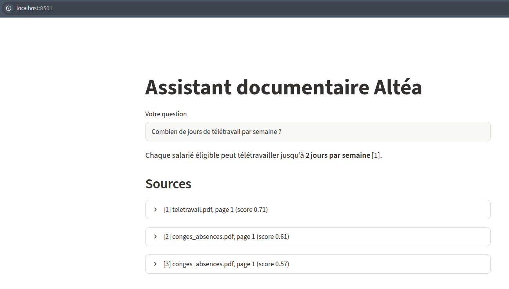

# Assistant documentaire Altéa (RAG)

Prototype d'assistant qui répond aux questions des salariés d'**Altéa Services** (entreprise fictive) à partir de sa documentation interne, **en citant toujours le document source**.



## Fonctionnement

```
docs/ (15 documents : RH, IT, General)
  │  1. collecte      etape1_collecte.py     pypdf + .txt, une entrée par page (source, page, service)
  │  2. nettoyage     etape2_nettoyage.py    espaces, sauts de ligne, mots coupés
  │  3. découpage     etape3_decoupage.py    chunks de 500 caractères, chevauchement 50
  │  4. indexation    etape4_indexation.py   paraphrase-multilingual-MiniLM-L12-v2 (384 dim) -> Chroma (cosinus)
  ▼
base_vectorielle/   (générée, non versionnée)
  │  5. recherche     etape5_recherche.py    top-k chunks, filtre optionnel par service
  │  6. génération    etape6_generation.py   prompt avec extraits numérotés -> LLM, temperature=0
  │  7. évaluation    etape7_evaluation.py   taux de bon document trouvé à k = 1, 3, 5
  ▼
  8. interface        app.py                 Streamlit : réponse + sources dépliables
```

| Composant | Choix |
|---|---|
| Extraction PDF | pypdf |
| Embeddings | `paraphrase-multilingual-MiniLM-L12-v2` (sentence-transformers, local) |
| Base vectorielle | Chroma, persistante, distance cosinus |
| LLM | `openai/gpt-oss-120b` via Groq (API compatible OpenAI) |
| Interface | Streamlit |

Le LLM est configurable : n'importe quelle API compatible OpenAI convient (Groq, OpenAI, Ollama en local…). Il suffit de modifier `.env`.

## Installation

Prérequis : Python 3.10 ou plus.

```bash
git clone https://github.com/rabieessayeh/rag-altea.git
cd rag-altea
python -m venv .venv
source .venv/bin/activate          # Windows : .venv\Scripts\activate
pip install -r requirements.txt
cp .env.example .env               # puis renseigner LLM_API_KEY dans .env
```

Contenu de `.env` :
```
LLM_BASE_URL=https://api.groq.com/openai/v1
LLM_API_KEY=<votre clé>
LLM_MODEL=openai/gpt-oss-120b
```
Pour utiliser Ollama en local : `LLM_BASE_URL=http://localhost:11434/v1`, `LLM_API_KEY=ollama`, `LLM_MODEL=llama3.2`.

Au premier lancement, le modèle d'embeddings (environ 470 Mo) est téléchargé depuis Hugging Face.

## Ordre de lancement

```bash
python etape4_indexation.py              # OBLIGATOIRE : crée base_vectorielle/ (enchaîne les étapes 1 à 4)
python etape5_recherche.py               # tests de recherche
python etape6_generation.py              # tests de génération
python etape7_evaluation.py              # évaluation de la recherche
python etape7_evaluation.py --generer    # + génère les 10 réponses à noter
streamlit run app.py                     # interface web
```

Les scripts `etape1` à `etape3` peuvent aussi être lancés seuls pour voir les pages lues, le nettoyage et les statistiques de découpage.

## Exemple

> **Question :** Combien de jours de télétravail par semaine sont autorisés chez Altéa ?
> **Réponse :** Chez Altéa, chaque salarié éligible peut télétravailler jusqu'à **2 jours par semaine** [1].
> **Sources :** [1] teletravail.pdf, page 1 (score 0,71)

## Résultats (étape 7)

| Mesure | Résultat |
|---|---|
| Bon document trouvé, k = 1 | 90 % (9/10) |
| Bon document trouvé, k = 3 | **100 %** (10/10) |
| Bon document trouvé, k = 5 | 100 % (10/10) |
| Questions hors documentation → phrase de repli | 2/2 |
| Réponses justes (10 questions) | … |
| Réponses correctement sourcées | … |

Corpus : 15 documents, 23 pages, 69 chunks indexés. Le détail et l'analyse des erreurs sont dans [`reponses.md`](reponse.md).

## Limites connues

- **En-têtes répétés** sur chaque page PDF, non supprimés : ils bruitent les premiers chunks (cause de l'échec « mutuelle » à k = 1).
- **Tableaux PDF** mal extraits par pypdf : libellés et valeurs sur des lignes séparées.
- **Découpage au caractère** : un chunk peut commencer ou finir au milieu d'un mot.
- **Réponses parfois incomplètes** : le LLM peut omettre une restriction présente dans l'extrait (par exemple, pas de télétravail le mardi).
- **Pas de gestion des droits** : le filtre `service` n'est pas une sécurité.
- **LLM hébergé** : les extraits sont envoyés à une API externe, ce qui ne convient pas tel quel à de vrais documents confidentiels.
- **Mise à jour manuelle** : un document modifié doit être supprimé de la base puis réindexé.
- Évaluation sur seulement 10 questions.

## Auteur

Rabie Es-Sayeh — TP « RAG en entreprise »
