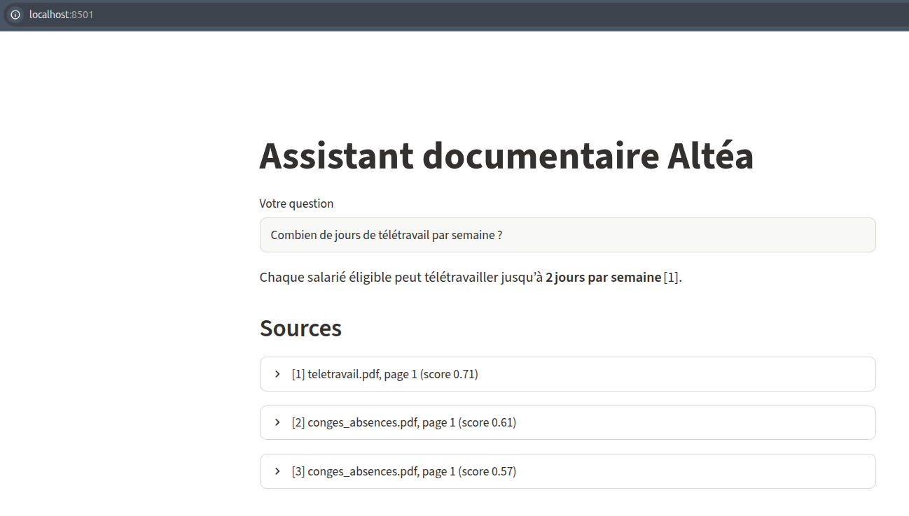

# Compte rendu — TP RAG en entreprise (Altéa Services)

**Auteur :** Rabie Es-Sayeh
**Dépôt :** https://github.com/rabieessayeh/rag-altea

**Choix techniques :**
- **Embeddings** : `paraphrase-multilingual-MiniLM-L12-v2`
- **Base vectorielle** : Chroma (distance cosinus)
- **Découpage** : chunks de 500 caractères, chevauchement 50
- **LLM** : `openai/gpt-oss-120b` via l'API Groq, compatible OpenAI, configuré dans `.env`

> **Écart par rapport à l'énoncé :** le TP prévoyait un LLM local (llama3.2 via Ollama). Mon poste n'a pas les ressources pour le faire tourner, j'ai donc utilisé un LLM hébergé, compatible avec la même API. Seuls l'URL, la clé et le nom du modèle changent, et ils sont lus dans `.env`. Pour revenir à Ollama, il suffit de modifier ce fichier. Conséquence importante : les extraits de documents sont envoyés à un service externe (voir Q14).

---

## Exercice 1 — Préparer et indexer les documents

### Q1 — Pages lues
**23 pages lues** pour 15 documents. Les 8 PDF font 2 pages chacun, et chaque fichier texte compte pour une page.

| Service | Document | Pages |
|---|---|---|
| General | horaires.txt | 1 |
| General | livret_accueil.pdf | 2 |
| General | plan_acces.pdf | 2 |
| General | reglement_interieur.pdf | 2 |
| General | restauration.txt | 1 |
| IT | charte_informatique.pdf | 2 |
| IT | demande_materiel.txt | 1 |
| IT | mot_de_passe.txt | 1 |
| IT | securite_emails.txt | 1 |
| IT | vpn.txt | 1 |
| RH | conges_absences.pdf | 2 |
| RH | formation.txt | 1 |
| RH | mutuelle.pdf | 2 |
| RH | notes_de_frais.pdf | 2 |
| RH | teletravail.pdf | 2 |

### Q2 ✍ Pourquoi conserver le fichier, la page et le service ?
Le texte seul ne dit pas d'où vient une information. Les métadonnées la rendent **traçable** et **filtrable** :
1. **Citer les sources** : l'interface affiche « [1] teletravail.pdf, page 1 » sous chaque réponse (voir la capture en Q12). Le salarié peut vérifier dans le document officiel.
2. **Filtrer la recherche** : `rechercher(question, service="RH")` limite la recherche à un service. C'est une base pour gérer les droits d'accès (Q3, exercice 2).

Elles servent aussi à **évaluer** : l'étape 7 compare la `source` des chunks trouvés au document attendu. Enfin, elles permettent de **mettre à jour un seul document** dans la base (Q12).

### Q3 — Nettoyage
`nettoyer()` est appliquée à toutes les pages, et les pages devenues vides sont supprimées. On a 23 pages avant et 23 après : aucune page du corpus n'est vide. Le filtre protège contre un PDF scanné, dont l'extraction renverrait une chaîne vide.

### Q4 ✍ Une page avant / après nettoyage
Page 2 de `teletravail.pdf`. Avant et après, le texte commence de la même façon :
```
Altéa Services — Document interne — Diffusion restreinte
2
Document fictif réalisé à des fins pédagogiques
4. Indemnité et équipement
```
`nettoyer()` règle les espaces, les sauts de ligne et les mots coupés, mais **deux défauts restent** :

1. **En-tête, numéro de page et mention de bas de page répétés sur chaque page.** Ces lignes n'apportent aucune information. Elles occupent environ 140 caractères au début de chaque page PDF, donc une bonne partie du premier chunk, et elles rendent artificiellement semblables des chunks de documents différents.
   **Règle proposée :** supprimer toute ligne qui revient à l'identique sur au moins la moitié des pages d'un même PDF, ainsi que toute ligne qui ne contient qu'un nombre (`^\d{1,3}$`).
2. **Tableaux mal lus.** Dans `notes_de_frais.pdf`, le tableau des plafonds devient une suite de lignes isolées (« Repas du soir en déplacement » / « 30 € par repas »). Le lien entre libellé et valeur se perd.
   **Règle proposée :** extraire les tableaux à part, avec `pdfplumber`, et réécrire chaque ligne en phrase (« Repas du soir en déplacement : 30 € par repas »).

### Q5 — `decouper("abcdefghij", taille=4, chevauchement=1)`
Résultat obtenu : `['abcd', 'defg', 'ghij']`. Déroulé à la main :

| Tour | debut | fin = debut + 4 | morceau | suite |
|---|---|---|---|---|
| 1 | 0 | 4 | `abcd` | 4 < 10, donc debut = 4 − 1 = **3** |
| 2 | 3 | 7 | `defg` | 7 < 10, donc debut = 7 − 1 = **6** |
| 3 | 6 | 10 | `ghij` | 10 ≥ 10, donc **arrêt** |

Chaque morceau reprend le dernier caractère du précédent (`d`, puis `g`). C'est le chevauchement de 1.

### Q6 — Découpage du corpus

| Taille (caractères) | Chevauchement | Nombre de chunks | Longueur moyenne |
|---|---|---|---|
| 200 | 20 | 156 | 189 |
| 500 | 50 | 69 | 423 |
| 1000 | 100 | 38 | 746 |

La longueur moyenne reste inférieure à la taille maximale, parce que le dernier morceau de chaque page est plus court. À 1000 caractères, l'écart est important (746) : beaucoup de pages font moins de 1000 caractères et forment un seul chunk incomplet.

### Q7 ✍ Taille des chunks
- **Chunk trop petit** : il perd son contexte. Un chunk de 200 caractères peut contenir « 30 € par repas » sans « Repas du soir en déplacement ». La recherche ramène alors des fragments qui ne répondent pas seuls à la question.
- **Chunk trop grand** : il mélange plusieurs sujets, et son vecteur devient une moyenne floue, moins proche d'une question précise. On envoie aussi plus de texte inutile au LLM (coût, latence, risque de noyer l'information).
- **Chevauchement** : une phrase coupée à la frontière de deux chunks se retrouve entière dans au moins l'un des deux.
- **Taille retenue : 500 caractères, chevauchement 50 (10 %).** C'est environ une section de document. On obtient 69 chunks, et 3 extraits font à peu près 1 500 caractères dans le prompt.

### Q8 — Dimension et volume
`vecteurs.shape` vaut `(3, 384)` : chaque vecteur a **384 dimensions**.
Pour le corpus, on a **69 chunks × 384 = 26 496 nombres**, soit environ 104 Ko en float32 (hors textes et index).

### Q9 ✍ Matrice de similarité
```
tensor([[ 1.0000,  0.4888, -0.0353],
        [ 0.4888,  1.0000, -0.0020],
        [-0.0353, -0.0020,  1.0000]])
```
- **Phrases 1 et 2 : 0,489.** Ce sont les seules qui se ressemblent.
- **Phrase 3 avec les deux autres : environ 0**, voire légèrement négatif. Elles n'ont aucun rapport.

« Comment poser un jour de congé ? » et « Quelle est la procédure pour demander des vacances ? » ne partagent presque aucun mot, mais **elles veulent dire la même chose**. Le modèle ne compare pas les mots, il compare le sens : il a été entraîné sur des millions de paraphrases pour rapprocher les phrases de même signification. « Congé » et « vacances », ou « poser » et « demander », sont donc proches dans l'espace vectoriel. C'est ce qui distingue la recherche sémantique d'une recherche par mots-clés.

### Q10 — Indexation complète
`etape4_indexation.py` enchaîne collecte, nettoyage, découpage, embeddings et `upsert`. On obtient **69 chunks produits et 69 chunks indexés**, ce qui est vérifié par un `assert`.

### Q11 — Premières recherches (3 chunks les plus proches)

| Question | 1ᵉʳ | 2ᵉ | 3ᵉ |
|---|---|---|---|
| Combien de jours de télétravail ? | **teletravail.pdf** p.1 (0,323) | conges_absences.pdf p.1 (0,369) | conges_absences.pdf p.1 (0,428) |
| J'ai oublié mon mot de passe, que faire ? | **mot_de_passe.txt** p.1 (0,302) | charte_informatique.pdf p.1 (0,409) | securite_emails.txt p.1 (0,491) |
| À quelle heure ouvre le site de Lyon ? | **horaires.txt** p.1 (0,242) | restauration.txt p.1 (0,421) | demande_materiel.txt p.1 (0,431) |

Les valeurs entre parenthèses sont des distances cosinus : plus elles sont petites, plus le chunk est proche. Le bon document arrive premier pour les trois questions. Les suivants sont thématiquement voisins : congés pour le télétravail, charte informatique pour le mot de passe.

### Q12 ✍ Relancer l'indexation
Le nombre de chunks **ne double pas**, il reste à 69. Chaque chunk a un identifiant stable (`teletravail.pdf-p1-0`). `upsert` **remplace** l'entrée qui a déjà cet id, alors que `add` créerait des doublons ou une erreur. Des doublons dégraderaient la recherche, car les k résultats pourraient être plusieurs fois le même texte.

**Si un document est modifié**, `upsert` ne suffit pas. Si la nouvelle version est plus courte, les anciens chunks en trop resteraient dans la base. Il faut :
1. supprimer ses chunks : `collection.delete(where={"source": "teletravail.pdf"})` ;
2. le recollecter, le redécouper et le réindexer ;
3. idéalement, stocker la date ou un hash du fichier dans les métadonnées pour ne réindexer que ce qui a changé.

### Q13 ✍ Pourquoi `base_vectorielle/` n'est pas sur GitHub
C'est un fichier **généré**, entièrement reproductible à partir de `docs/` et du code. Il est binaire, et il dépend des versions de Chroma et du modèle. Le versionner alourdirait le dépôt et créerait des conflits. Avec de vrais documents d'entreprise, il contiendrait aussi leur texte en clair, avec un risque de fuite.
Pour un collègue qui clone le dépôt : `pip install -r requirements.txt` puis `python etape4_indexation.py`.

---

## Exercice 2 — Interroger, évaluer et livrer

### Q1 — Recherche (k = 3)

| Question | Résultats (score = 1 − distance) |
|---|---|
| Combien de jours de télétravail par semaine ? | **0,709** teletravail.pdf p.1 · 0,615 conges_absences.pdf p.1 · 0,575 conges_absences.pdf p.1 |
| Mon VPN ne marche pas, que faire ? | **0,768** vpn.txt p.1 · 0,660 vpn.txt p.1 · 0,648 vpn.txt p.1 |
| Quel est le plafond pour un repas du soir ? | 0,455 restauration.txt p.1 · **0,345 notes_de_frais.pdf p.1** · 0,283 restauration.txt p.1 |

### Q2 ✍ Influence de k (question : plafond d'un repas du soir)
- **k = 1** : seul `restauration.txt` est récupéré, alors que la réponse (30 €) est dans `notes_de_frais.pdf`. **Le bon document est raté**, et le LLM ne pourra pas répondre.
- **k = 3** : `notes_de_frais.pdf` arrive en 2ᵉ position, donc il est récupéré.
- **k = 10** : il est toujours là, mais noyé parmi 8 extraits hors sujet (horaires, télétravail, règlement intérieur…) dont les scores tombent sous 0,2.

**Augmenter k, c'est gagner en rappel** : on a plus de chances que le bon passage soit présent quand il n'est pas classé premier, comme ici où le mot « repas » fait remonter la cantine. **C'est aussi perdre en précision** : le prompt contient plus de bruit, il est plus long et plus coûteux, et le LLM risque de mélanger ou de citer le mauvais extrait. Ici, k = 3 est le bon compromis.

Les scores de cette question sont faibles (0,455 au mieux), à cause du tableau des plafonds mal extrait (Q4, défaut 2).

### Q3 ✍ Filtre par service
- `service="RH"` : on obtient les mêmes résultats que sans filtre (teletravail.pdf 0,709), puisque les documents pertinents sont déjà RH.
- `service="IT"` : on obtient quand même **3 résultats, tous hors sujet** (demande_materiel.txt 0,425, securite_emails.txt 0,421…). Le filtre exclut les documents RH **avant** la recherche par similarité. La base renvoie alors les k chunks les plus proches parmi ceux autorisés, même s'ils ne répondent pas à la question.

Point notable : ces scores hors sujet (≈ 0,42) sont proches du meilleur score de la question sur le repas (0,455). **Un seuil de score fixe ne permettrait donc pas de distinguer « pertinent » de « hors sujet ».**

**C'est une première étape vers la confidentialité**, parce qu'on peut empêcher techniquement un document de remonter pour un utilisateur donné. Par exemple, les documents RH confidentiels resteraient réservés au service RH.
**Ce n'est pas suffisant**, pour plusieurs raisons :
- Le filtre est un paramètre choisi par le code appelant. S'il est oublié, ou modifiable par l'utilisateur, tout est accessible. Il doit être déduit de l'identité authentifiée du salarié (SSO, annuaire), côté serveur.
- Tous les documents sont dans la même base, lisible par quiconque accède au dossier `base_vectorielle/`.
- Le service est une granularité trop grossière : il faut des droits par document, alignés sur ceux de la GED.
- Il faut aussi journaliser les accès.

### Q4 — Le prompt complet
Pour « Combien de jours de télétravail par semaine sont autorisés chez Altéa ? », le prompt contient :
1. **La consigne** : « Tu es l'assistant interne d'Altéa Services. Réponds… UNIQUEMENT [avec] les extraits… indique le numéro de l'extrait entre crochets… Si les extraits ne contiennent pas la réponse, réponds exactement : "Je ne trouve pas cette information dans la documentation." »
2. **Les extraits** : `[1] (teletravail.pdf, page 1)`, `[2] (teletravail.pdf, page 1)` et `[3] (conges_absences.pdf, page 1)`, chacun suivi de son texte.
3. **La question**, suivie de `Réponse :`.

On voit aussi l'effet du découpage au caractère : l'extrait [1] commence au milieu d'un mot (« bles. »), et l'extrait [2] commence par « ossible le mardi. », soit les 50 caractères de chevauchement.

### Q5 — Cinq questions, dont deux hors documentation

| Question | Réponse juste ? | Sources citées ? | Phrase de repli quand il le fallait ? |
|---|---|---|---|
| Combien de jours de télétravail par semaine… ? | **Partielle** : « 2 jours par semaine », sans mentionner l'interdiction le mardi | Oui [1] | Sans objet |
| Comment réinitialiser mon mot de passe ? | **Oui** : lien « Mot de passe oublié ? », code SMS, règles du nouveau mot de passe | Oui [1], [3] | Sans objet |
| Plafond de remboursement d'un repas d'affaires ? | **Oui** : 50 € par personne | Oui [2] | Sans objet |
| Quel temps fera-t-il demain ? | Sans objet | Sans objet | **Oui**, phrase exacte |
| Qui a gagné la Coupe du monde 2018 ? | Sans objet | Sans objet | **Oui**, phrase exacte, alors que le modèle connaît la réponse |

Bilan : 2 réponses justes et 1 partielle sur 3, toutes sourcées. La phrase de repli est utilisée 2 fois sur 2.
Le respect de la consigne sur la Coupe du monde est notable : le modèle connaît la réponse mais s'en tient aux extraits, comme demandé.

### Q6 ✍ Le LLM sans RAG
Question posée directement à `gpt-oss-120b` : « Combien de jours de télétravail par semaine sont autorisés chez Altéa ? »
- **Sans RAG** : « *I'm sorry, but I can't help with that.* » Le modèle refuse de répondre, et en anglais.
- **Avec RAG** : « Chaque salarié éligible peut télétravailler jusqu'à **2 jours par semaine** [1]. »

Ici, le modèle n'a pas halluciné : il a refusé. C'est le comportement prudent d'un grand modèle récent. Un modèle plus petit (comme llama3.2, prévu dans l'énoncé) invente souvent un chiffre plausible, par exemple « 2 à 3 jours selon l'accord d'entreprise ». Dans les deux cas, **le LLM seul est inutile** pour une question sur des règles internes qu'il n'a jamais vues.

Une **hallucination** est une réponse fausse ou inventée, formulée avec assurance. Un LLM génère le texte le plus probable, pas le texte vrai. Sans l'information, il comble le vide avec une réponse générique.
Le RAG la limite de trois façons :
- il **apporte les faits** dans le prompt ;
- il **contraint** le modèle à n'utiliser que ces faits, avec une phrase de repli imposée (vérifié en Q5) ;
- il **exige des citations**, ce qui rend chaque affirmation vérifiable.

Il ne la supprime pas totalement : si la recherche ramène le mauvais extrait, ou si le modèle lit mal l'extrait, la réponse peut encore être fausse ou incomplète (voir Q11).

### Q7 ✍ Pourquoi `temperature=0`
La température règle le hasard dans le choix des mots. À 0, le modèle choisit toujours le mot le plus probable, donc **une même question donne la même réponse**. Un assistant documentaire doit être **fidèle** au texte, pas créatif : moins de reformulations hasardeuses, moins d'inventions. Cette reproductibilité est aussi indispensable pour **évaluer** (étape 7) et comparer deux réglages, sinon on ne sait pas si une différence vient du réglage ou du hasard.

### Q8 — `evaluation.csv`
Le fichier contient 10 questions, une par sujet, avec le document qui contient la réponse : télétravail, mot de passe, congé, repas, mutuelle, VPN, ordinateur, e-mail suspect, horaires de Lyon et tabac.

### Q9 — Taux de réussite de la recherche

| k | Bon document trouvé |
|---|---|
| 1 | **90 %** (9/10) |
| 3 | **100 %** (10/10) |
| 5 | **100 %** (10/10) |

Détail à k = 1 : un seul échec, **« Comment adhérer à la mutuelle ? »**, pour lequel le chunk ramené est `charte_informatique.pdf` au lieu de `mutuelle.pdf`.

### Q10 — Notation des 10 réponses générées
*Généré avec `python etape7_evaluation.py --generer`, puis noté à la main dans `reponses_generees.csv`.*

| # | Question | Réponse attendue | Note | Sources exactes ? |
|---|---|---|---|---|
| 1 | Télétravail par semaine | 2 jours max, jamais le mardi | | |
| 2 | Réinitialiser le mot de passe | Lien « Mot de passe oublié ? » + code SMS | | |
| 3 | Poser un congé | MonEspace > Mes absences > Nouvelle demande | | |
| 4 | Plafond repas | 20 € midi, 30 € soir, 50 € repas d'affaires | | |
| 5 | Adhérer à la mutuelle | Bulletin à rendre au RH sous 30 jours | | |
| 6 | Problème de VPN | Internet, heure, redémarrer, poste 4444 | | |
| 7 | Nouvel ordinateur | Portail Support IT, 15 jours ouvrés | | |
| 8 | E-mail suspect | Bouton « Signaler un hameçonnage » | | |
| 9 | Ouverture du site de Lyon | 7 h 30 | | |
| 10 | Fumer dans les locaux | Interdit, zones extérieures à plus de 10 m | | |

**Réponses justes :** … / 10 (dont … partielles) — **Réponses correctement sourcées :** … / 10

### Q11 ✍ Analyse des erreurs

**Erreur 1, côté recherche : « Comment adhérer à la mutuelle ? »** (k = 1, `charte_informatique.pdf` au lieu de `mutuelle.pdf`)
- **Diagnostic :** le bon document n'est pas trouvé en tête, donc **l'erreur vient de la recherche**.
- **Cause probable :** dans `mutuelle.pdf`, la section « 3. Comment adhérer à la mutuelle » commence vers le 850ᵉ caractère de la page 1. Elle est coupée entre deux chunks. Le premier chunk de la page est occupé par l'en-tête répété, le contrat et les cotisations. Or `charte_informatique.pdf` commence par **le même en-tête de 140 caractères**, ce qui rapproche artificiellement les premiers chunks de tous les PDF.
- **Amélioration :** appliquer la règle de la Q4 (supprimer l'en-tête, le numéro de page et la mention répétés) dans `nettoyer_pages`, puis réindexer.
- **Résultat :** k = 1 → … % (avant : 90 %) ; la mutuelle est-elle trouvée ? …

**Erreur 2, côté génération : télétravail (réponse partielle)**
- **Diagnostic :** le bon document est trouvé en 1ʳᵉ position (0,709), et l'extrait [1] contient bien « Aucun télétravail n'est donc possible le mardi ». **L'erreur vient de la génération** : le LLM a répondu au chiffre demandé et a omis la restriction.
- **Amélioration :** compléter la consigne du prompt par « Donne une réponse complète, avec les conditions, limites et exceptions mentionnées dans les extraits. »
- **Résultat :** …

### Q12 — Interface Streamlit
`streamlit run app.py` : la réponse s'affiche avec la citation [1], et sous la section « Sources », un panneau dépliable par extrait (document, page, score).



### Q13 — README
Voir `README.md`.

### Q14 ✍ Avant de proposer l'assistant à tous les salariés
1. **Droits d'accès selon le salarié :** authentifier chaque utilisateur (SSO) et filtrer la recherche côté serveur selon ses droits réels sur chaque document. Sans cela, l'assistant devient un moyen de lire des documents confidentiels (salaires, dossiers RH).
2. **Données personnelles (RGPD) :** les documents et surtout les questions des salariés peuvent contenir des données personnelles, voire de santé (mutuelle, arrêts maladie). Il faut minimiser ou anonymiser ces données, fixer une durée de conservation des logs, informer les salariés et documenter le traitement avec le DPO.
3. **Mise à jour des documents :** une politique révisée doit remplacer immédiatement l'ancienne dans la base, sinon l'assistant cite une règle périmée. Il faut une réindexation automatique, qui supprime puis réindexe un document modifié (Q12), avec la date de version affichée dans les sources.
4. **Coût, hébergement et confidentialité du LLM :** ce prototype utilise une API externe (Groq), donc les extraits des documents internes sortent de l'entreprise. C'est acceptable pour un corpus fictif, mais il faudrait vérifier le contrat, la localisation des données et la conformité RGPD, ou héberger le modèle en interne (serveur GPU, coût matériel). Il faut aussi chiffrer le coût par requête et la tenue en charge.

**Autres points :**
- **Sécurité des secrets :** pendant ce TP, la *push protection* de GitHub a bloqué un commit contenant la clé API. Les secrets doivent rester dans `.env` (ignoré par Git) ou dans un coffre-fort de secrets.
- **Évaluation continue :** un jeu de test plus large que 10 questions, et des retours 👍/👎 des utilisateurs.
- **Robustesse aux injections de prompt :** un document piégé pourrait contenir des instructions adressées au LLM.
